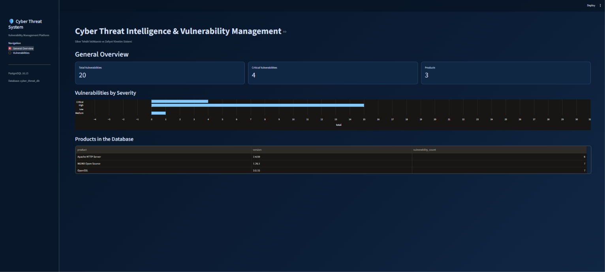
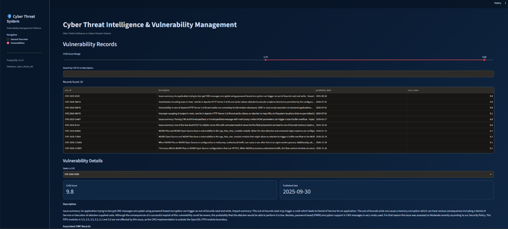
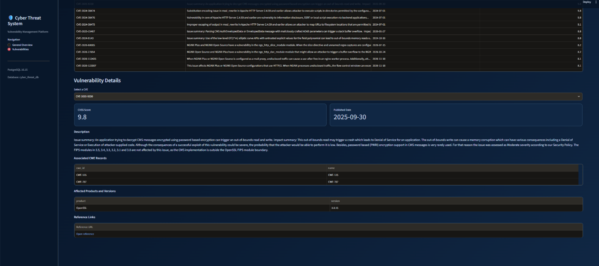

# Cyber Threat Intelligence and Vulnerability Management System

A PostgreSQL-based database project designed to organize, manage, and analyze cybersecurity vulnerabilities, affected products, infrastructure assets, and patch information.

The project is developed as part of the Database Systems course at Dogus University.

## Project Overview

The system provides a structured database for managing Common Vulnerabilities and Exposures (CVE), Common Weakness Enumeration (CWE), affected product versions, organizational assets, patches, and analyst reviews.

It also includes a Python-based Streamlit interface for viewing vulnerability statistics and exploring CVE records.

## Project Objectives

- Design a relational database for cybersecurity vulnerability management.
- Model relationships between vulnerabilities, weaknesses, products, and infrastructure assets.
- Apply relational database design principles and normalization.
- Enforce data integrity through primary keys, foreign keys, and constraints.
- Perform CRUD operations and analytical SQL queries.
- Integrate Python with PostgreSQL.
- Present database information through a lightweight web interface.

## Features

### Database Management

- CVE and CWE records
- Vendors, products, and product versions
- Affected product-version relationships
- Organizational assets and infrastructure
- Patch and patch application records
- Analyst reviews and audit logs
- Referential integrity and relational constraints

### Vulnerability Analysis

- CVE severity classification using CVSS scores
- Vulnerability counts by product
- Identification of assets not affected by known vulnerabilities
- Analytical SQL queries based on project requirements

### Streamlit Application

- General vulnerability overview
- Critical vulnerability statistics
- Vulnerability distribution by severity
- Product and version summaries
- CVE search and CVSS score filtering
- CWE and affected product details
- External CVE reference links

## Application Screenshots

### General Overview

The dashboard presents vulnerability statistics, severity distribution, and product summaries.



### Vulnerability Details

The vulnerability records page provides CVE search, filtering, and detailed vulnerability information.



### Vulnerability Records and References

Additional vulnerability information, including related weaknesses, affected products, and external references.



## Technologies

| Technology | Purpose |
|---|---|
| PostgreSQL 16 | Relational database management |
| Python 3 | Database connectivity and application logic |
| Streamlit | Web-based user interface |
| Pandas | Query result processing |
| Psycopg2 | Python–PostgreSQL connectivity |
| SQL | Database schema, CRUD, and analytical queries |
| NVD | Public vulnerability data source |

## Database Design

The database consists of 21 relational tables covering vulnerability information, products, infrastructure assets, patches, and analyst activities.

The design includes:

- Primary and foreign key constraints
- One-to-many and many-to-many relationships
- Composite keys
- Associative entities
- Entity specialization and category modeling
- Normalization principles

The database schema is defined in `schema.sql`.

## Project Structure

```text
cyber-threat-db/
│
├── app.py
├── schema.sql
├── README.md
│
├── data/
│   ├── sample_data.sql
│   ├── real_cve_import.sql
│   ├── apache_selected_6.csv
│   ├── openssl_selected_7.csv
│   └── nginx_selected_7.csv
│
├── docs/
│   ├── conceptual_model.md
│   ├── data_dictionary.md
│   ├── data_sources.md
│   ├── normalization.md
│   ├── relational_schema_diagram.md
│   ├── requirements.md
│   ├── diagrams/
│   │   ├── use_case_diagram.puml
│   │   └── use_case_diagram.png
│   └── screenshots/
│       ├── general-overview.png
│       ├── vulnerability-details-1.png
│       └── vulnerability-details-2.png

├── queries/
│   ├── analysis_queries.sql
│   └── crud_operations.sql
│
└── scripts/
    ├── db_connection.py
    └── generate_real_cve_import.py
```

## Data Sources

Public vulnerability information is collected from the National Vulnerability Database (NVD).

The project includes selected CVE records related to:

- Apache HTTP Server 2.4.59
- OpenSSL 3.0.15
- NGINX Open Source 1.26.1

The current real-data import contains 20 selected CVE records.

CVE identifiers, descriptions, CVSS information, CWE associations, and reference URLs are retained as technical source data.

Official resources:

- [National Vulnerability Database (NVD)](https://nvd.nist.gov/)
- [CVE Program](https://www.cve.org/)
- [Common Weakness Enumeration (CWE)](https://cwe.mitre.org/)

## Installation and Setup

### 1. Clone the repository

```bash
git clone https://github.com/irembayrakk27/bim381-cyber-threat-db.git
cd bim381-cyber-threat-db
```

### 2. Create a Python virtual environment

```bash
python3 -m venv .venv
source .venv/bin/activate
```

### 3. Install dependencies

```bash
pip install streamlit pandas psycopg2-binary
```

### 4. Create the PostgreSQL database

```bash
createdb cyber_threat_db
```

### 5. Create the database schema and import data

```bash
psql -d cyber_threat_db -f schema.sql
psql -d cyber_threat_db -f data/sample_data.sql
psql -d cyber_threat_db -f data/real_cve_import.sql
```

The PostgreSQL role used by the Python application must have permission to connect to the database and read its tables. Update the connection settings in `app.py` and `scripts/db_connection.py` when using a different local PostgreSQL role.

### 6. Run the database connection test

```bash
python scripts/db_connection.py
```

### 7. Launch the Streamlit application

```bash
streamlit run app.py
```

Open the local address provided by Streamlit, usually:

```text
http://localhost:8501
```

## SQL Queries

The `queries/` directory contains:

- `analysis_queries.sql`: Analytical queries associated with functional requirements.
- `crud_operations.sql`: Create, read, update, and delete operation examples.

## Documentation

Detailed project documentation is available in the `docs/` directory:

| Document | Description |
|---|---|
| Requirements | Project scope and functional requirements |
| Conceptual Model | ER/EER entities and relationships |
| Data Dictionary | Table and attribute definitions |
| Relational Schema | Relational database structure |
| Normalization | 1NF, 2NF, and 3NF analysis |
| Data Sources | Data origin and validation principles |

## Project Scope

This project focuses on database design, data management, SQL querying, and database-backed visualization.

It does not perform live penetration testing, automated network scanning, or autonomous vulnerability detection.

## Academic Project

**Course:** Database Systems (BİM 381)
**University:** Dogus University
**Department:** Software Engineering
**Project:** Cyber Threat Intelligence and Vulnerability Management System
