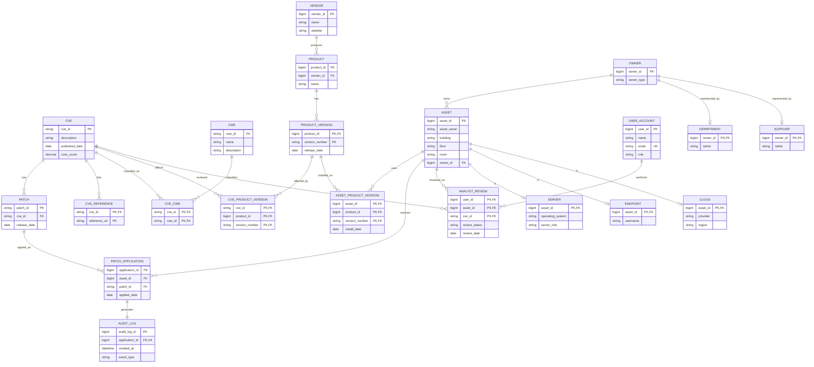

# İlişkisel Şema Diyagramı

Bu diyagram, Siber Tehdit İstihbaratı ve Zafiyet Yönetim Sistemi'nin ilişkisel şemasını göstermektedir. Kavramsal ER/EER modeli ayrı olarak `conceptual_model.md` dosyasında açıklanmıştır.

## 1. İlişkisel Şema

---

## 2. EER Modelleme Kuralları

### 2.1. Zayıf Varlık: ProductVersion

- ProductVersion, Product varlığına bağımlıdır.
- Kısmi anahtarı `version_number` niteliğidir.
- Birincil anahtarı `(product_id, version_number)` bileşimidir.

### 2.2. Uzmanlaşma: Asset

Asset üst varlığı üç alt türe ayrılır:

- Server
- Endpoint
- Cloud

Uzmanlaşma total ve disjoint olarak tanımlanmıştır.
Her Asset tam olarak bir alt türe ait olmalıdır. Mermaid ER gösterimi bu iki kısıtı tek başına ifade edemediğinden, bu açıklama modelin bağlayıcı kuralıdır. Alt tür üyeliğinin zorunlu ve birbirini dışlayan yapısı uygulama katmanında doğrulanacaktır.

### 2.3. Kategori / Union Type: Owner

Owner kategorisi Department ve Supplier varlıklarının birleşiminden oluşur.
- OWNER.owner_type yalnızca `DEPARTMENT` veya `SUPPLIER` değerini alabilir.
- owner_type ile ilgili alt tür kaydının eşleşmesi uygulama katmanında doğrulanır.

- Her Asset tam olarak bir Owner'a bağlıdır.
- Bir Owner, Department veya Supplier türünde olmalıdır.
- Bir Owner aynı anda hem Department hem Supplier olamaz.
- Bir Department veya Supplier birden fazla Asset'e sahip olabilir.
- Her Owner tam olarak bir Department veya Supplier tarafından temsil edilmelidir; iki türde birden temsil edilemez. Mermaid ER gösterimi bu category kısıtını tek başına ifade edemediğinden, bu açıklama modelin bağlayıcı kuralıdır. owner_type ile alt tür tablosunun eşleşmesi ve alt tür üyeliği uygulama katmanında doğrulanacaktır.

### 2.4. Üçlü İlişki: AnalystReview

AnalystReview, User, Asset ve CVE arasındaki üçlü ilişkiyi temsil eder. BR-10 gereğince ilişkiye katılan User'ın role değeri Analyst olmalıdır. Bu kural veritabanı trigger'ı ile doğrulanır.

- Aynı User–Asset–CVE birleşimi için tek inceleme kaydı tutulur.
- review_status yalnızca `Open`, `In_Review` veya `Closed` değerlerini alabilir. Bu kural CHECK kısıtıyla sağlanır.

### 2.5. PatchApplication ve AuditLog

- PatchApplication, Asset ile Patch arasındaki M:N ilişkinin uygulama kaydıdır.
- Her Asset–Patch çifti için tek uygulama kaydı tutulur. Bu kural ilişkisel şemada UNIQUE(asset_id, patch_id) kısıtıyla sağlanır.
- Her PatchApplication için tam olarak bir AuditLog kaydı oluşturulur.
- AuditLog, PatchApplication ile 1:1 ilişkilidir.
- İlişkisel şemada AUDIT_LOG.application_id alanı NOT NULL, UNIQUE ve FOREIGN KEY kısıtlarına sahip olacaktır. Her PatchApplication için AuditLog oluşturulması BR-06 trigger'ı ile sağlanacaktır.

## 3. Özel Nitelik Kuralları

- CVE severity, CVSS skorundan türetilir.
- CVE reference çok değerli niteliktir ve CVE_REFERENCE ile modellenmiştir.
- Asset location, building, floor ve room alt niteliklerinden oluşur.
- AnalystReview kavramsal olarak üçlü ilişkidir; ilişkisel modele aktarılırken ayrı tabloya dönüştürülür.
